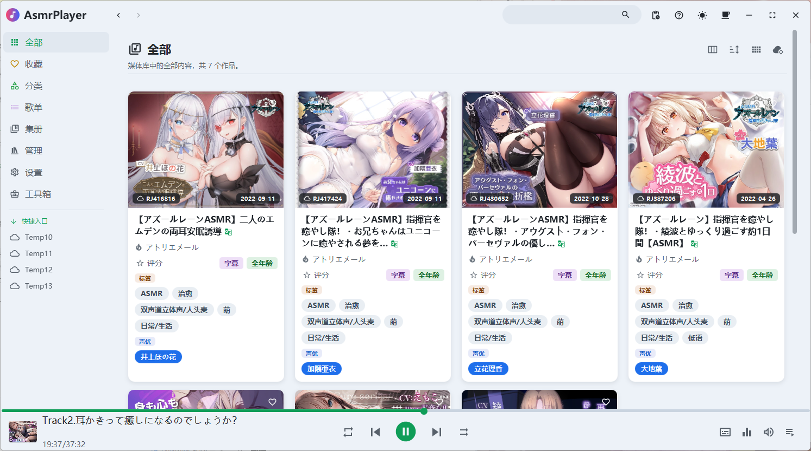
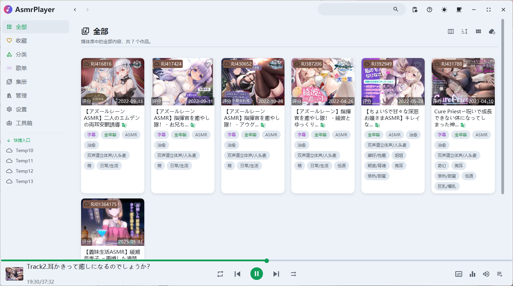

# AsmrPlayer

AsmrPlayer是一款管理播放一体的播放器，主打音声，对某D音声网站进行适配，针对音声进行设计与实现。在传统播放器的基础上（包括播放，管理，桌面歌词等等），推出GalGame模式，探索并尝试将音声打造成小型GalGame，让音声的表现更加生动。

## 功能

- 媒体库扫描、导入与分类浏览（全部、收藏、社团、声优、标签、文件夹）
- DLsite 元数据抓取与同步
- 本地磁盘、Alist/OpenList 双存储来源
- 音频播放，支持播放列表、播放历史、倍速与音频设备选择
- 歌词/字幕：LRC、VTT、SRT，桌面歌词、字幕简繁转换、AI 翻译
- Galgame 模式

## 截图
<p>
  
  
</p>

<p>
  
  
</p>


## 环境要求

- JDK 25（`JAVA_HOME` 指向 JDK 25）
- Maven 3.9 或更新版本
- 支持平台：Windows 10/11 x64、macOS 11+（Apple Silicon / Intel）、Linux x64
- Linux 需要 glibc 2.38+（Ubuntu 24.04、Debian 13、Fedora 39 或更新），
  并具备 dbus、systemd、libbsd、gnutls 等基础系统库

仓库已内置各平台 VLC 运行库，通常不需要系统安装 VLC。内置库缺失时会自动回退到系统 VLC。
内置库的格式支持与许可说明见 [vlc/README.md](vlc/README.md)。

## 快速开始

```bash
git clone <仓库地址>
cd AsmrPlayer

# 开发运行
mvn javafx:run
```

首次运行会自动创建开发数据目录 `dev-data/`。

打包可执行 jar：

```bash
mvn clean package -DskipTests
java -Djavafx.enablePreview=true -jar target/asmrPlayer-1.4.2.jar
```

> 主界面使用了 JavaFX 26 的预览特性（`HeaderBar`），因此必须带
> `-Djavafx.enablePreview=true`，否则启动会失败。
> `java -jar` 运行的是“使用环境”，数据目录为系统用户目录，不是 `dev-data/`。
> 开发调试请使用 `mvn javafx:run` 或 IDE 直接运行。

生成 jlink 运行时镜像：

```bash
mvn javafx:jlink
```

输出在 `target/app`，启动器为 `target/app/bin/app`（Windows 为 `app.bat`）。
jlink 产物只是模块化运行时镜像，不会自动携带仓库里的 `vlc/`。
正式分发建议使用 jpackage 制作 app-image，并把运行库放进应用目录
（Windows 用 `--app-content`，Linux/macOS 由 `package.sh` 复制并写 `-Dvlc.dir`，见下）；
启动日志出现 `已加载内置 VLC native 库` 即表示路径正确。

一键打包（Windows）：

```cmd
package.bat            :: jlink 镜像 + app-image + msi + exe（默认）
package.bat image      :: 只出 jlink 镜像 + app-image，不制作安装包
package.bat --skip-image exe   :: 复用现有 app-image，只重烧安装包
package.bat -h         :: 全部参数
```

版本号默认读取 `pom.xml` 的 `<version>`，可用 `APP_VERSION` 环境变量覆盖。

产物位置：

| 产物 | 路径 |
| --- | --- |
| jlink 运行时镜像 | `target\app` |
| 免安装 app-image | `target\image\AsmrPlayer\AsmrPlayer.exe` |
| MSI 安装包 | `target\jpackage\AsmrPlayer-<版本>.msi` |
| Burn 安装包 | `target\jpackage\AsmrPlayer-<版本>.exe` |

两个安装包都由同一个 app-image 通过 `--app-image` 生成，内容完全一致；
它们需要 WiX Toolset（v3 的 candle/light 或 v4/v5 的 wix），缺失时脚本在开始构建前就报错并给出安装命令。

一键打包（Linux / macOS，未测试过）：

```bash
./package.sh           # Linux 出 deb + rpm，macOS 出 dmg + pkg
./package.sh deb       # 只出 deb（需 fakeroot）
./package.sh dmg       # 只出 dmg（需 Xcode 命令行工具）
./package.sh --skip-image pkg   # 复用现有 app-image，只重烧安装包
./package.sh -h        # 全部参数
```

产物位置：

| 产物 | 路径 |
| --- | --- |
| 免安装 app-image | `target/image/AsmrPlayer/bin/AsmrPlayer`（Linux）<br>`target/image/AsmrPlayer.app`（macOS） |
| deb / rpm | `target/jpackage/asmrplayer_<版本>_amd64.deb` / `asmrplayer-<版本>-1.x86_64.rpm` |
| dmg / pkg | `target/jpackage/AsmrPlayer-<版本>.dmg` / `.pkg` |

Linux 与 macOS 不走 `--app-content`：jpackage 只文档化了该选项在 Windows 下的落地位置，
所以脚本把 `vlc/<平台>` 连同许可文本复制进应用目录（Linux `lib/app/vlc`、macOS `Contents/app/vlc`），
并在启动器写入 `-Dvlc.dir=$APPDIR/vlc`，由 `VlcNativeLoader` 自行挑选平台子目录。
macOS 的 `.icns` 由 `favicon.png` 现场用 `sips` + `iconutil` 生成；
构建产物只做 ad-hoc 签名（Apple Silicon 不签名无法启动），没有开发者证书与公证。

## 数据目录（重点）

所有运行期文件由 `AppPaths` 统一管理，与启动时的工作目录无关。
数据目录按以下优先级确定：

1. 系统属性 `-Dasmr.data.dir=<绝对路径>`（最高优先级）
2. 开发环境：项目根目录下的 `dev-data/`
3. 使用环境：操作系统标准用户数据目录

### 开发环境与安装环境如何区分

| 运行方式 | 判定 | 数据目录 |
| --- | --- | --- |
| IDE 运行、`mvn javafx:run` | 类路径为 `target/classes` 目录，且能找到 `pom.xml` | `<项目根>/dev-data/` |
| jpackage 安装包 | 启动器写入 `jpackage.app-path` 属性 | 用户数据目录 |
| `java -jar` | 类路径是 jar 文件，不算开发环境 | 用户数据目录 |

用户数据目录：

- Windows：`%APPDATA%\AsmrPlayer`
- macOS：`~/Library/Application Support/AsmrPlayer`
- Linux：`$XDG_DATA_HOME/AsmrPlayer`，未设置时为 `~/.local/share/AsmrPlayer`

### 开发环境数据目录怎么用

- **自动使用**：用 IDE 运行 `cn.tealc.asmr.Main`（或 `App`），或执行 `mvn javafx:run`，
  数据会自动写入项目根目录的 `dev-data/`，不会污染用户数据目录。
- **首次运行**：目录不存在时自动创建，无需手动建目录。
- **重置数据**：关闭程序后删除 `dev-data/` 即可，下次启动会重新初始化数据库和配置。
  该操作会清空开发环境的媒体库、播放历史和设置。
- **换一个位置**：推荐在 IDE 运行配置的 VM options 中加入
  `-Dasmr.data.dir=D:\asmr-data`；使用 Maven 运行时，可在 `pom.xml` 的
  `javafx-maven-plugin` `<options>` 中追加 `<option>-Dasmr.data.dir=D:\asmr-data</option>`。
  路径建议使用绝对路径。
- **测试隔离**：`mvn test` 通过 Surefire 使用 `target/test-data/`，不会读写 `dev-data/`。
- **不迁移旧文件**：旧版本的 `settings-storage-source.json` 不会自动读取或迁移。
  如需沿用旧配置，手动将其重命名为 `setting.json` 后放入数据目录。

`dev-data/` 已被 `.gitignore` 忽略，不要提交其中的数据库和日志。


## 内置 VLC

- 运行库位于 `vlc/<平台>/`，由 `VlcNativeLoader` 在启动时自动发现并设置 JNA 搜索路径。
- 开发环境从 `<项目根>/vlc` 加载，安装环境从启动器目录附近的 `vlc/` 加载。
- 当前内置库为纯音频裁剪版，支持 MP3、WAV、FLAC、OGG（Vorbis/Opus/Speex）、
  M4A/M4B（AAC-LC）、AIFF/AU/CAF 等；不支持 WMA、RealAudio、ALAC、视频和
  RTSP/HLS 等流媒体协议。
- 启动日志出现 `已加载内置 VLC native 库` 表示加载成功。

详细平台要求、来源与许可见 [vlc/README.md](vlc/README.md)。

## 项目结构

```text
src/main/java/cn/tealc/asmr/
  App.java / Main.java     启动入口
  player/                  vlcj 播放封装与内置 VLC 加载
  source/                  MediaSource 抽象（本地 / OpenList）
  service/                 媒体库、元数据、缓存、播放列表等业务服务
  dao/                     SQLite 数据访问
  ui/                      JavaFX 界面（主界面、播放器、设置、弹窗）
  subtitle/                字幕解析与显示
  properties/              应用设置模型
  utils/AppPaths.java      数据目录与路径统一入口
src/main/resources/        FXML、CSS、图片、音频等资源
vlc/                       各平台内置 VLC 运行库
```
## 为爱发电项目，永久免费
倘若喜欢本程序，欢迎请开发者补充一瓶营养快线，加上BUFF,XXXX。

您可以按以下格式留言：[名称]:[想说的话]


### 感谢以下赞赏支持
| 名字 | 留言 | 金额 |
| -----| ---- | ---- |
| 春季攻势 |   | 30.00 |
| 米顺蕾 |   | 20.00 |
| 全群最菜的吃饼小恐龙 |加油   | 20.00 |
| 花瑶 |加油   | 20.00 |
| 小埋 |很喜欢这款软件，加油！   | 20.00 |
| XCproject |辛苦了，祝天天开心。   | 20.00 |
| RANCE |非常感谢！   | 40.00 |
| 仁语 |   | 10.00 |
| 威廉俾斯麦 |   | 50.00 |
| **川 |   | 30.00 |


